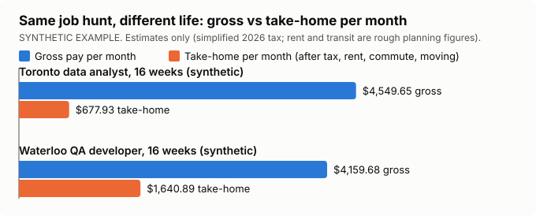

# coop-offer-comparator

Compare co-op job offers by **real take-home pay**: what is left after
estimated tax, CPP and EI, rent, commuting and moving costs. Headline pay
is not the number that matters.

- A Python 3.12 command-line tool that uses only the standard library: no
  dependencies, no API keys, no network calls.
- A static browser demo in [`docs/`](docs/) whose math is tested to match
  the Python exactly. Live at
  <https://battlettt.github.io/coop-offer-comparator/>.
- Plain-English lessons in [`docs/money-concepts.md`](docs/money-concepts.md).

> **Disclaimer: these are estimates, not payroll, tax or financial advice.**
> Income tax, CPP/QPP, EI and QPIP use simplified 2026 brackets and rates.
> City rent and transit presets are rough 2026 planning figures, not quotes.
> Your real paycheque and tax return will differ. Check numbers that matter
> with the employer's payroll team or the CRA / Revenu Québec.



## Why headline pay misleads

Say you have two co-op offers. One pays $28/hour in Toronto and the other
pays $24/hour in Waterloo. The first looks like the better deal: it pays
$1,440 more over the term. But you also have to live in the city where the
job is. Toronto rent is higher, the transit pass costs more, and you may
pay to move. Once those are taken off, the "better" offer can leave you
with **less than half** as much money each month. This tool does that
arithmetic for you, shows every step, and tells you when the difference
between two offers is too small to matter.

## Install and run

You need Python 3.12 or newer. Nothing else.

**Option A: run from source (no install)**

```sh
git clone https://github.com/battlettt/coop-offer-comparator
cd coop-offer-comparator
python -m coop_compare compare samples/offers.json
```

**Option B: install it (editable)**

```sh
pip install -e .
coop-compare compare samples/offers.json      # same as python -m coop_compare
```

### Commands

| Command | What it does |
|---|---|
| `compare <offers.json> [--format text\|json\|html\|csv] [--out FILE]` | Side-by-side table, ranking, gap to the best offer, a verdict per offer, break-even pay, rent sensitivity, and the disclaimer |
| `explain <offers.json> "<label>"` | A beginner walkthrough of ONE offer, from gross pay to take-home, showing the arithmetic for every line |
| `breakeven <offers.json> "<target>" "<adjust>"` | What pay the `adjust` offer needs for its monthly take-home to equal the `target` offer's. The answer is checked by running the calculation again at that pay |
| `validate <offers.json>` | Lists numbered errors and warnings. Exits with code 1 if there are any errors |
| `init [--force]` | Writes an example `offers.json` (SYNTHETIC EXAMPLE) to the current folder. It will not overwrite an existing file unless you pass `--force` |

Exit codes: `0` means OK, `1` means the input has problems, `2` means the
command was typed wrong.

## The offers file

Start with `python -m coop_compare init`, then edit the file it writes. JSON
does not allow comments, so any key that starts with `_` is treated as a
comment and ignored.

```json
{
  "_note": "SYNTHETIC EXAMPLE",
  "offers": [
    {
      "label": "Toronto data analyst (synthetic)",
      "city": "Toronto",
      "hourly_rate": 28.0,
      "hours_per_week": 37.5,
      "term_weeks": 16,
      "arrangement": "hybrid",
      "commute": {"mode": "transit"},
      "other_monthly": [{"name": "phone plan", "amount": 45}, {"name": "groceries", "amount": 380}],
      "moving_costs": [{"name": "moving van", "amount": 350}],
      "lump_sums": [{"name": "signing bonus", "amount": 1000, "taxable": true}]
    }
  ]
}
```

| Field | Required? | Notes |
|---|---|---|
| `label` | yes | Free text. Must be unique, because `explain` and `breakeven` find offers by label |
| `city` | yes | A preset city fills in rent, the transit pass and the province. Any other city gets a warning, and you must then give rent and transit yourself |
| `province` | no | Ontario, British Columbia, Quebec or Alberta (or ON/BC/QC/AB). If you leave it out, it comes from the city preset, or defaults to Ontario |
| `hourly_rate` + `hours_per_week` **or** `annual_salary` | exactly one | Giving both is an error. Giving neither is also an error |
| `term_weeks` | yes | Any positive whole number. Co-op terms are usually 16 weeks |
| `arrangement` | yes | `remote`, `hybrid` or `onsite` |
| `rent_per_month` | yes, unless the city has a preset | Your number always beats the preset |
| `commute` | yes, unless the job is remote | `{"mode": "transit", "transit_pass_per_month": 100}`, `{"mode": "driving", "km_per_day": 30, "cost_per_km": 0.35, "parking_per_month": 80, "days_per_week": 5}`, or `{"mode": "none"}` |
| `other_monthly` | no | A list of `{name, amount}` costs that repeat every month |
| `moving_costs` | no | A list of `{name, amount}` one-time costs. Shown on their own line and also spread over the term |
| `lump_sums` | no | A list of `{name, amount, taxable}` items, such as a signing bonus or a relocation payment. Shown separately and never mixed into monthly pay |

**Validation rules.** Errors are numbered and say how to fix the problem.
They include: a missing field, negative money, both pay styles, neither pay
style, a non-whole term, an onsite job with no commute, an unsupported
province, and duplicate labels. Some things are warnings instead of
errors: a city with no preset, an unknown field, a remote job with a transit
pass, a hybrid job with no commute, and missing driving parking or days
(the tool then assumes free parking and 5 days onsite / 3 days hybrid, and
says so). The tool never quietly fills in a number it does not know.

### Overriding presets

There are presets for Toronto, Waterloo, Ottawa, Vancouver, Montreal and
Calgary. Each one is a typical one-bedroom rent plus an adult monthly
transit pass, as **rough 2026 planning figures, not quotes**. To use your own
numbers, just set `rent_per_month` or `commute.transit_pass_per_month`.
Every report says where each number came from: *you supplied*, *city preset
(estimate)*, *default*, or *assumed*.

| City | Province | Rent / month | Transit pass / month |
|---|---|---|---|
| Toronto | Ontario | $2,450 | $160 |
| Waterloo | Ontario | $1,900 | $100 |
| Ottawa | Ontario | $2,050 | $136 |
| Vancouver | British Columbia | $2,700 | $110 |
| Montreal | Quebec | $1,750 | $104 |
| Calgary | Alberta | $1,750 | $118 |

All presets live in one file, [`coop_compare/presets.py`](coop_compare/presets.py).

## A full worked example (SYNTHETIC EXAMPLE, estimates)

These are the two made-up offers in [`samples/offers.json`](samples/offers.json).
Both terms are 16 weeks. One month is counted as 4.333 weeks (52 ÷ 12), so
16 weeks is 16 ÷ 4.333 = **3.6926 months**.

| Line | Toronto data analyst (synthetic) | Waterloo QA developer (synthetic) |
|---|---:|---:|
| Pay | $28.00/h × 37.5 h/week | $24.00/h × 40 h/week |
| **Gross, whole term** | $28 × 37.5 × 16 = **$16,800.00** | $24 × 40 × 16 = **$15,360.00** |
| Gross per month | $4,549.65 | $4,159.68 |
| Annualised (gross × 52 ÷ 16) | $54,600.00 | $49,920.00 |
| Federal income tax | $1,643.30 | $1,441.70 |
| Ontario income tax | $655.52 | $573.85 |
| CPP | $935.52 | $849.84 |
| EI | $273.84 | $250.37 |
| **Total deductions** | **$3,508.18** (20.9%) | **$3,115.76** (20.3%) |
| **Net, whole term** | **$13,291.82** | **$12,244.24** |
| Rent / month | $2,450.00 (Toronto preset) | $1,150.00 (user supplied, shared flat) |
| Transit / month | $160.00 (preset) | $100.00 (preset) |
| Phone + groceries / month | $425.00 | $425.00 |
| Living per month → whole term | $3,035.00 × 3.6926 = $11,207.02 | $1,675.00 × 3.6926 = $6,185.09 |
| Moving (one-time) | $350.00 (≈ $94.78/month spread over the term) | $0.00 |
| Signing bonus | $1,000.00 − $231.50 est. tax = $768.50 | none |
| **Take-home, whole term** | $13,291.82 − $11,207.02 − $350.00 + $768.50 = **$2,503.31** | $12,244.24 − $6,185.09 = **$6,059.15** |
| **Take-home per month** | **$677.93** | **$1,640.89** |
| Take-home per week | $156.46 | $378.70 |

**Verdict:** the Waterloo offer leaves you **$962.97 more per month**, even
though its hourly rate is $4 lower. **Break-even:** the Toronto offer would
need about **$37.41/hour** (+33.6%) to match Waterloo's monthly take-home,
assuming the same costs. **Sensitivity:** if either rent guess is off by
$200/month, the ranking does not change.

How a few of these lines are worked out:

- **Federal tax:** $54,600 × 14% = $7,644.00, minus the basic personal
  credit of $16,452 × 14% = $2,303.28, gives $5,340.72 for a year. Then
  × 16/52 = **$1,643.30**.
- **Ontario tax:** $53,891 × 5.05% plus $709 × 9.15%, minus
  $12,989 × 5.05%, gives $2,130.43 for a year. Then × 16/52 = **$655.52**.
- **CPP:** 5.95% × ($16,800 − $3,500 × 16/52) = 5.95% × $15,723.08 =
  **$935.52**.
- **EI:** 1.63% × $16,800 = **$273.84**.
- **Signing-bonus tax:** tax on ($54,600 + $1,000) minus tax on $54,600 is
  $1,000 × (14% + 9.15%) = **$231.50**.

Run `python -m coop_compare explain samples/offers.json "Toronto data analyst (synthetic)"`
to see this walkthrough written out for a beginner.

## How the tax estimate works, and where it stops

1. **Annualise.** Tax brackets are set per year, but a co-op term is only part
   of a year. Payroll handles this by asking "what if you earned this much all
   year?" So we scale the term's gross pay up to a full year
   (× 52 ÷ weeks), work out a year of federal and provincial tax, then scale
   it back down (× weeks ÷ 52). If you skipped this step and taxed four
   months of pay as though it were a whole year, most of it would fall under
   the basic personal amount. The estimate would then show far less tax
   than your paycheques will actually have taken off.
2. **Brackets + one credit.** We use simplified 2026 marginal brackets for
   federal tax, Ontario, British Columbia, Quebec and Alberta, plus the basic
   personal amount credited at the lowest rate. Quebec residents also get the
   16.5% federal abatement.
3. **CPP/QPP and EI** are charged on the term's actual pay. CPP uses a
   prorated $3,500 exemption. Both are capped at their annual maximums,
   which a normal co-op term never reaches. Quebec uses QPP, the lower Quebec
   EI rate, and QPIP.
4. **Lump sums** use the bonus method: tax on (annualised pay + bonus) minus
   tax on annualised pay.

**What this leaves out:** CPP/EI tax credits, the Canada employment
amount, the Ontario surtax and health premium, other provincial credits and
low-income reductions, CPP2, tuition credits, RRSP deductions, benefits and
union dues, and any other job you had earlier in the same year. Withholding
also differs from the tax you finally owe. Many students who work only one
or two terms get a refund at tax time. Treat every figure as an estimate.

## Project structure

```
coop_compare/        Python package (standard library only)
  tax_tables.py      simplified 2026 brackets, CPP/QPP, EI, QPIP (estimates)
  presets.py         city rent + transit presets (rough 2026 planning figures)
  model.py           validation -> numbered errors/warnings, normalised offers
  calc.py            ALL the math: gross, deductions, take-home, ranking,
                     break-even, sensitivity (formulas documented at the top)
  report.py          text / JSON / HTML / CSV reports and the `explain` walkthrough
  cli.py             argparse CLI (compare, explain, breakeven, validate, init)
  example.py         the SYNTHETIC EXAMPLE written by `init`
docs/
  index.html, app.js browser demo (GitHub Pages: main /docs); app.js ports the math
  money-concepts.md  plain-English lessons for beginners
  CHAPTER.md         portfolio chapter thesis + figure description
  figure.svg         gross vs take-home chart (SYNTHETIC EXAMPLE, generated)
samples/offers.json  two SYNTHETIC EXAMPLE offers
tools/make_figure.py regenerates docs/figure.svg from the calculator
tests/               unittest suite, fixtures, and the Node parity runner
```

## Running the tests

```sh
python -m unittest discover -s tests -t .
```

The suite covers both ways of entering pay, every deduction line and its
cap, annualising, net and take-home, moving costs and lump sums, ranking
and the about-tied rule, break-even (each result is checked by computing
take-home again at that pay), sensitivity, presets and where numbers came
from, every validation error, all four report formats, the CLI, the docs,
and **demo parity**. For parity, `tests/js_runner.js` runs `docs/app.js` under
Node on shared fixtures, and the tests check that every issue, number,
ranking and verdict matches Python exactly (the floats are bit-identical).
The parity tests need `node` on your PATH. Without it they are skipped.

## Disclaimer

Every tax, rent and transit figure in this project is an **estimate** based
on stated assumptions. It is not payroll, tax or financial advice. All sample
offers are **SYNTHETIC EXAMPLES**: they are not real employers, offers or
pay.

## License

MIT, see [LICENSE](LICENSE).
